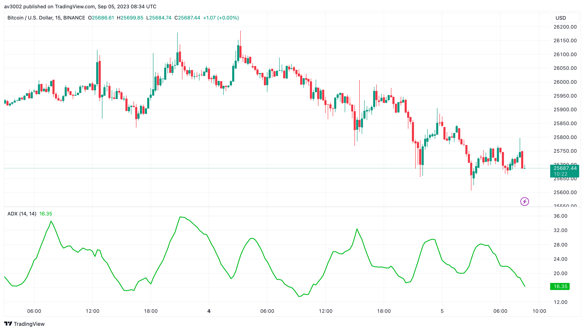
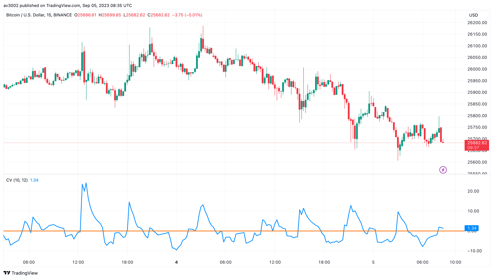
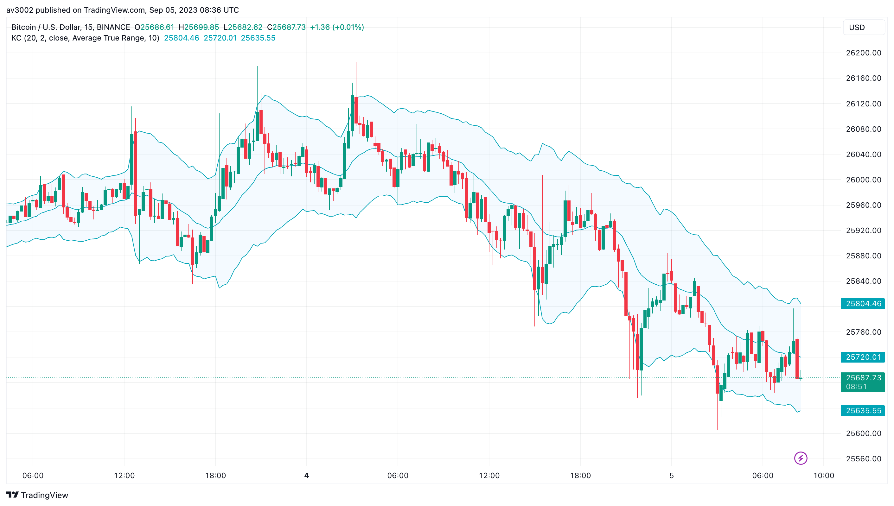
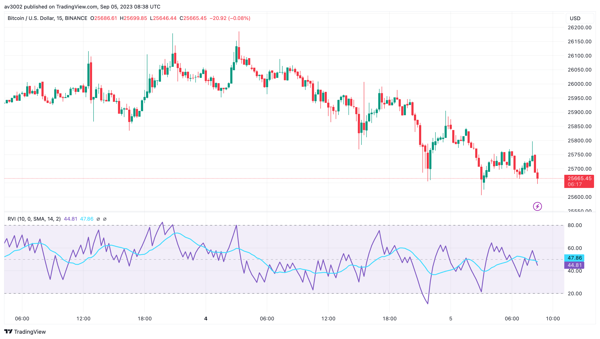
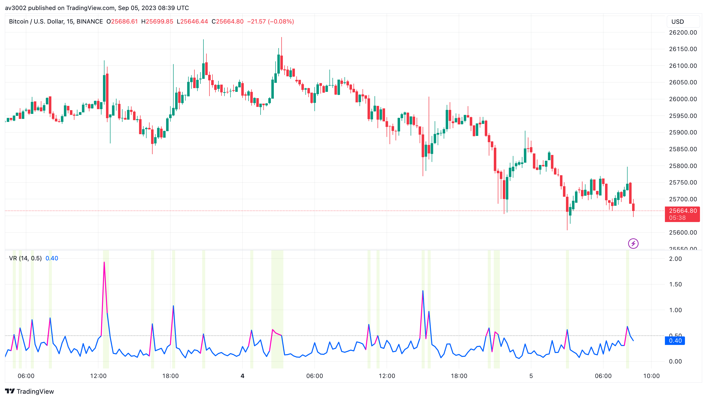

# Pine Strategy Indicators v4

Five open-source TradingView indicators written in Pine Script v6: Average Directional Index, Chaikin Volatility, Keltner Channels, Relative Volatility Index and Volatility Ratio. Part of [GAINZ](https://gainz-trading-indicators.vercel.app), 35 indicators across seven collections.

| Indicator                                               | Type       | Script                                                                        |
| ------------------------------------------------------- | ---------- | ----------------------------------------------------------------------------- |
| [Average Directional Index](#average-directional-index) | Trend      | [`average-directional-index.pine`](indicators/average-directional-index.pine) |
| [Chaikin Volatility](#chaikin-volatility)               | Volatility | [`chaikin-volatility.pine`](indicators/chaikin-volatility.pine)               |
| [Keltner Channels](#keltner-channels)                   | Volatility | [`keltner-channels.pine`](indicators/keltner-channels.pine)                   |
| [Relative Volatility Index](#relative-volatility-index) | Volatility | [`relative-volatility-index.pine`](indicators/relative-volatility-index.pine) |
| [Volatility Ratio](#volatility-ratio)                   | Volatility | [`volatility-ratio.pine`](indicators/volatility-ratio.pine)                   |

## Average Directional Index

Measures how strong a trend is, whichever way it's heading, on a scale from 0 to 100.

Below 20 the market is drifting; above 25 a trend has real strength. A rising ADX means the trend is gaining force.

| Setting       | Default |
| ------------- | ------- |
| ADX smoothing | 14      |
| DI length     | 14      |

Based on TradingView's built-in Average Directional Index indicator.

## Chaikin Volatility

The rate of change of an average of each bar's high–low range.

A sharp rise means ranges are widening fast, often near panicky tops and bottoms. A falling line means the market is calming down.

| Setting    | Default |
| ---------- | ------- |
| Length     | 10      |
| ROC length | 12      |

## Keltner Channels

A 20-bar EMA with bands set two ATRs above and below it, the space between them shaded.

Closes outside the channel signal a strong push. Inside it, the middle line works like a magnet.

| Setting    | Default |
| ---------- | ------- |
| Length     | 20      |
| Multiplier | 2.0     |
| ATR length | 10      |
| Average    | EMA     |

Based on TradingView's built-in Keltner Channels indicator.

## Relative Volatility Index

RSI's logic applied to volatility: it asks whether price swings are bigger on up bars or on down bars.

Above 50, volatility sides with the buyers; below 50, with the sellers. Best used to confirm another signal, with 80 and 20 as the outer bands.

| Setting | Default |
| ------- | ------- |
| Length  | 10      |
| MA      | SMA 14  |

Based on TradingView's built-in Relative Volatility Index indicator.

## Volatility Ratio

Compares the current bar's true range with the range of the last 14 bars.

Readings above the breakout level are shaded on the chart: bars that are unusually wide for this market, often where a breakout begins.

| Setting        | Default |
| -------------- | ------- |
| Length         | 14      |
| Breakout level | 0.5     |

## How to use

1. Open the indicator's `.pine` file in `indicators/` and copy the code.
2. In TradingView, open the Pine Editor, paste the code and save it.
3. Click **Add to chart**, then change the defaults in the indicator's settings.

## Disclaimer

For learning and research. Indicators describe what price has done, not what it will do. Nothing here is financial advice.

## License

[MIT](LICENSE). Indicators based on someone else's work keep their original author's terms.
